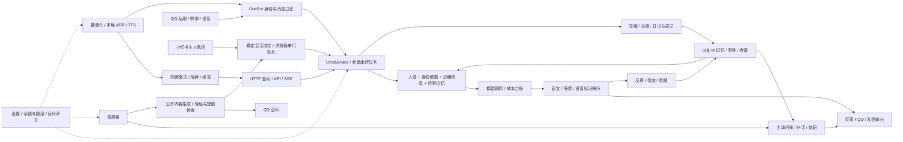

# BiZhi 全功能复核与分阶段优化方案

实施更新：下面保留审查时的基线结论；当前完成情况、部署证据和待验收项以 [实施与验收记录](OPTIMIZATION_DELIVERY_20261101.md) 为准。

日期：2026-11-01。审查基线：`54ebdd2`，本轮附带两项前端修复，未改后端行为、运行设置或生产记忆。

## 1. 结论与实施边界

项目已有较完整的陪伴闭环：多渠道对话 → 上下文与记忆 → 回复/情绪 → 反思/主动行为 → 语音和社交输出。主要短板已不是缺少功能按钮，而是记忆可信度、后台任务与实时对话的协调，以及日常陪伴和管理界面的混杂。

建议顺序是：**数据与行为可靠 → 前端状态正确 → 页面信息分层 → 连续而自然的陪伴 → 长期运行验证**。保留 Node、SQLite、原生 HTML/CSS/JS、五个主导航和现有角色素材，不迁移框架，不把这轮扩成 RTC、Live2D 或更多平台接管。

本文是当前代码、测试、隔离复现、真实服务只读检查与 Gemini 两轮截图评审的综合结果。Gemini 仅提供设计意见，不作为程序正确性的证据。旧版 `OPTIMIZATION_PLAN.md`、`UI_PLAN.md`、`PRESENCE_PLAN.md` 和 `VOICE_PLAN.md` 中已经实现的事项不再列为待开发。

### 本轮已经落地

| 项目 | 原问题 | 修改与验证 |
|---|---|---|
| 桌宠宽度 | 隐藏导航后 `.main` 被自动放入 `.app` 的 86px 首列；1280px 视口实测主区仅 86px | `web/style.css` 为 `body.mode-pet .app` 设置单列；实测主区恢复 1280px。浏览器测试新增主区与应用宽度比较，补充立绘宽度检查 |
| 未保存设置 | 在设置里修改姓名，切换陪伴页朗读开关后，`fillSettings()` 覆盖草稿；还会连带提交未保存的其他陪伴参数 | `web/app.js:savePresenceToggle` 只发送被点击的字段，保留脏表单；未编辑的朗读控件同步服务端值，已编辑控件保留；请求中禁用重复点击。浏览器回归验证姓名、摄像头额度、请求负载及朗读控件同步 |

其余条目均为待实施方案，尤其记忆压缩与反思证据问题尚未修复。没有重启生产 Node/NapCat，没有发测试 QQ、发帖、清空记忆或更换账号。网页静态资源修改在重新载入时生效；已打开页面需刷新。

## 2. 功能全景及依赖

图中“输出”不代表一次 API 返回就等于用户已收到；发送提交、回执确认、结果未知必须继续区分。公开内容与主人私聊的记忆权限不能因共用模型而合并。

### 模块和用户能力对照

| 能力 | 当前入口与实现 | 关键关联 / 保留条件 |
|---|---|---|
| 登录、会话权限、跨站保护 | `index.js`、`http-security.js`、`identity.js` | 登录前不读私人数据；登出吊销；角色身份与机器人账号校验保留 |
| 网页对话、图片、流式停止 | `web/app.js`、`chat.js`、`llm.js`、`sse.js` | 取消生成、重复点击、断流部分内容、消息落库与成本必须一致 |
| QQ 私聊与群聊 | `channels/onebot.js` | 主人完整记忆，访客/群聊受限；群白名单与 @ 行为不变 |
| 人设、表达、情绪 | `prompt.js`、`mood.js`、`neuro.js`、`effects.js` | 同一身份跨网页/QQ连贯；内在状态是软件模拟，不是生理测量 |
| 近期/重点/长期记忆 | `memory.js`、`reflect.js`、`forgetting.js`、`db.js` | 原话保留；摘要覆盖范围可追溯；推断不能冒充事实 |
| 日记、周记、交接信 | `memory.js`、`weekly-report.js`，`data/daily/weekly/letters` | 生成失败不标记完成；上下文预算独立于历史展示范围 |
| 惦记、主动找你、QQ补一句 | `intentions.js`、`scheduler.js`、`onebot.js` | 安静时段、未回复上限、最新入站取消、日/小时额度、预算检查 |
| 陪伴舞台、桌宠、字幕 | `web/app.js`、`presence.js`、`brain.js` | 角色图、字幕、表情继续使用现有来源；设备状态真实 |
| 摄像头、感官记忆 | `presence.js`、`senses.js` | 开关和配额；离开页面停止采集；看到的内容不编造成共同经历 |
| 本地识别与语音回复 | `asr.js`、`tts.js`、`local-tts.js`、`local-tts-worker.js`、`voice-style.js` | 识别失败可恢复；TTS降级可见；不重复朗读旧消息 |
| QQ语音会话 | `voice-call.js`、`onebot.js` | 是异步语音消息；保留账号世代、回合世代、提交裁决、未知结果不重发 |
| 表情/学图/找图 | `stickers.js`、`learned-images.js`、`sticker-search.js` | 否定指令、冷却、来源、大小与路径约束；不因UI换成网格而改变发送集合 |
| 空间动态和评论 | `channels/qzone.js`、`social.js` | Cookie归属、文字发布、回复去重、隐私检查、配额 |
| 小红书笔记/互动/私信/数据 | `channels/xhs.js`、`xhs-actions.js`、`xhs-safety.js`、`browser/cdp.js` | 专用浏览器归属、单队列、稳定会话绑定、验证码停下、陌生人逐条确认 |
| 配置、成本与后台运行 | `config.js`、`budget.js`、`scheduler.js`、`processes.js`、`logger.js`、`net.js` | 原有配置字段和默认关闭策略；进程只操作本项目；估算费用不冒充账单 |
| 串行化、存储与通用约束 | `serial.js`、`db.js`、`util.js`、`privacy.js` | 事务、备份、重入、幂等、数据访问范围是所有前台动作的基础 |

明确保留现有未实现边界：关注、视频笔记、自动改资料、空间图片说说、抖音/微信接管、一键导出；小红书通知完整评论/@解析也不列作已完成。UI中的草稿不得暗示平台已发布。

## 3. 当前证据与覆盖范围

审查期间 `npm test`：301 条，296 通过、0 失败、5 跳过；跳过项是单列的本机语音模型/真实音频链路测试。语法检查 127/127 通过。修改后浏览器两项端到端测试再次通过，包括新增的草稿与桌宠断言；UI静态契约12/12通过，`git diff --check`通过。浏览器使用安装的 Chromium，设备用假摄像头/假麦克风；音频有 2.2 秒可播放结果，但假麦克风识别为空，因此不证明实际语音识别准确率。

既有 UI 探针在 1440、1024、768、390、337 × 五主视图，共25组返回零问题。它有阈值和覆盖缺陷，**不能称为完整 WCAG AA 合格或全部页面无问题**。桌宠宽度就是反例。

2026-11-01 02:49（UTC+8）只读检查：真实服务 `mock=false`、配置了模型 Key、QQ已连接且身份匹配、SQLite `quick_check=ok`，状态接口无健康告警。数据库有网页/QQ/群聊消息及空间发布记录；这些存量记录不证明这次审查进行了收发或发布。

严格最近24小时的事件记录：`qq_down` 68、`qq_auto_recover_error` 39，小红书 `graph_failed/dm_failed/badge_failed` 各33，`reflect_error` 4。这是事件条数，可能含周期重复、既往重启与恢复中的状态，不能换算成68次独立断网或故障率。它足以说明后续要检查抖动原因和失败退避，不能以“现在在线”宣布长期运行稳定。

截图范围：五主视图 × 五宽度25张；另补登录、桌宠、设置顶部/陪伴分区、重点记忆、长期记忆、信件空态；修复后另有桌宠截图。Gemini看到其中17张（五页桌面/手机10张，加补充7张）。未穷举每个折叠区、对话框、平台登录态、键盘状态。详见[截图索引](../data/review-20261031/gallery.html)与[讨论取舍](GEMINI_UI_REVIEW_20261101.md)。

## 4. 问题清单和优先级

P1：可能影响记忆、用户输入或核心使用，应先处理。P2：可控退化、体验或持续运行风险。这里没有把未复现的风险写成生产事故。

| ID / 优先级 | 证据与影响 | 建议处理 | 状态 |
|---|---|---|---|
| R01 / P1 摘要覆盖错误 | `memory.js:160–216`：只截取约5000字符，却把全部 older 标为已压缩。隔离40条长消息，32条标记、仅8条进入请求，24条未进入 | 按实际输入消息ID提交摘要覆盖记录；分批游标处理长消息，失败不推进；历史数据只读扫描后再可回滚重建 | 已复现，待修 |
| R02 / P1 无依据重点记忆 | `reflect.js:110`直接写入模型 memories；core更新才有原话证据检查。注入与原话无关的“巴黎见面”仍入 mid | 所有事实记忆保留来源消息、证据、置信状态；推测与事实分离；矛盾可更正 | 已复现，待修 |
| R03 / P1 设置草稿覆盖 | `savePresenceToggle`全量采集未保存 presence 后调用全表填充 | 单字段写入、保留草稿；下一阶段做字段级修订冲突 | 本轮已修 |
| R04 / P1 桌宠窄列 | 1280px视口 `.main=86px`，网格未随隐藏导航改变 | 桌宠单列；断言宽度和实际可见范围 | 本轮已修 |
| R05 / P1 连接稳定性缺口 | 最近24h多个恢复/轮询失败；当前连接正常并不冲突 | 按错误类别、持续时长、恢复次数聚合；检验现有退避/重启策略；登录失效转人工一次提醒 | 有运行证据，根因待分类 |
| R06 / P2 UI探针失真 | `ui-audit.mjs:215`把18.66px普通字、14px粗体当大字；遗漏桌宠；部分遮挡排除；旧断言正向对照无效 | 修正阈值、加入故意错误的检测样例、补焦点和末尾控件可见性 | 代码确认，待修 |
| R07 / P2 语音票据长期保留 | `voice-call.js`的tickets只增加和改变状态；纯函数1000场结束后保留1000张票据 | 有界已结算缓存；保留在途和未知记录的安全窗口；晚到回执不重复扣量 | 已复现，待修 |
| R08 / P2 遗忘数学与展示不一致 | `forgetting.js:33`在名义半衰期剩36.8%，非50%；曲线重置时间，30天记忆当前0.169，图起点0.85 | 统一半衰期定义或改名时间常数；曲线从当前真实强度延伸；兼容旧排名 | 已复现，待修 |
| R09 / P2 跨渠道回复参数差异 | `chat.js:177`流式直接用配置；`:272`非流式根据心情调整temperature/maxTokens | 共用生成配置函数，渠道差异显式传参，保留现有合理字数限制 | 代码确认，待修 |
| R10 / P2 后台维护阻塞 | `chat.js:331`维护队列持主人锁等待LLM；`scheduler.js:879`多个任务顺序await | 先记录等待/执行时延，再拆快照计算与短事务提交；优先实时对话 | 结构风险，未测生产尾延迟 |
| R11 / P2 历史展示不完整 | 消息接口取活动会话有限条数，UI限量；用户查旧话与模型检索是不同需要 | 独立历史分页/会话入口，保持提示词预算；不要全量塞上下文 | 功能缺口，待设计 |
| R12 / P2 主动行为连续性 | 惦记主要新增，需完善完成/撤销识别；QQ补话依据通道内lastInbound | 统一主人活动版本；Web/QQ切换都能使过期补话失效；过期事项不反复追问 | 跨渠道竞态待定向复现 |
| R13 / P2 成本口径 | `llm.js`价格与汇率常量；无usage情形的普通/流式估计口径需统一 | 模型费率表+日期；明确estimated；并发任务预算预留 | 台账改进，非精确账单承诺 |

R01不会删除原始消息；问题是把未参与摘要的消息过早标成已压缩，后续摘要可能漏过它们。R02是确定可注入的代码缺口，不代表已证明生产模型真的编造了该示例。

## 5. 稳定性和记忆改造细案

### 5.1 压缩覆盖与历史修复

1. 新增摘要覆盖记录：session、源消息起止/实际ID、长消息片段偏移、摘要版本、完成时间、状态。迁移可重复运行，旧记录保持可读。
2. 从最旧未覆盖消息向前处理，按token/字符双预算切块。单条超长消息必须分段或独立摘要，不能截断后视作全文已覆盖。
3. LLM失败/取消/空输出不推进游标；摘要与覆盖记录在同一事务提交。不能把调用LLM放进SQLite事务。
4. 摘要合并时保存来源链；人工事实、核心档案优先，推断留低置信状态。避免每次覆盖唯一摘要导致细节不可追溯。
5. 先针对历史 `compacted=1` 与可识别摘要覆盖做只读报告。旧版没有覆盖元数据时标“无法证明覆盖”，不能猜测哪些事实必然丢失。重建写新版本，旧版本保留回滚。
6. 验收：40/400条、长单条、图片消息、失败重试、重启中断均无源ID遗漏；重复执行不重复写入；两个压缩请求竞态只提交一份。

### 5.2 记忆真实性和更正

事实记忆增加 source_message_ids、evidence、kind（事实/偏好/约定/推测）、valid_from、supersedes_id、confidence状态。人设设定与用户陈述分开，模型自己的话不能自证事实。

原文包含校验仅能证明“说过这些字”，不能证明改写后的结论成立。先做结构、消息角色、证据跨度校验，再对矛盾/高影响事实降级为待确认；不要让一次额外模型判断成为唯一保证。比如“朋友不吃香菜”不能写成“主人不吃香菜”，“以前不喝咖啡，现在偶尔喝”需带时间。

UI允许“这条不准确”“现在变了”，显示简短来源和时间。更正保留旧版本及审计关系，不直接清空历史。检索优先有效且较新的明确事实；旧冲突条目不同时作为当前事实注入。

### 5.3 队列、重试和交付一致性

先加每种任务的 queued_at/start/end、等待时长、超时、取消、attempt、关联消息ID；只记必要元信息。对话优先级高于摘要/日记/运营，但同一个外部浏览器仍必须串行。

维护采用“读快照 → 可取消计算 → 短锁校验版本 → 提交”；版本过期重算或丢弃结果，不拿旧会话数据覆盖新会话。反思任务可合并连续轮次，限制积压；拒绝简单 `Promise.all` 并行共享浏览器/会话状态。

QQ恢复区分进程不存在、WS未接通、身份不符、需要扫码、平台限制、短暂网络错误。重启加指数退避和上限，已经启动的进程不重复拉起；身份不符绝不通过重试绕过。小红书失效停止同类定时读取并汇总一次可处理通知，减少三种任务同时刷失败事件。

公开发布/QQ发送保留“草稿→准备→提交→确认/未知/失败”。未知结果先核查，不自动重复发布。恢复和前端重试都不能产生重复副作用。

## 6. 前端逐页方案

### 6.1 总体布局与设计规范

保留深海蓝和现有角色；复用 `style.css` 的实色文本与间距token，不直接采用Gemini的低对比暗灰文字。默认正文15.5–16px，辅助13–14px，标题22px；行高正文1.55–1.65。间距4/8/12/16/24/32，卡片16px圆角，控件以44px为主、触屏主动作48px。

桌面导航保留图标加文字，宽度沿用86px或经实测再压到80px。聊天主列可读宽度约720–800px，侧栏280–320px；1024以下先收起侧栏而非挤压正文。移动端单列，五入口底栏占位明确；`100dvh`加安全区，键盘行为需真机验证，不能认为改单位就已解决。

普通正文对比度目标≥4.5:1，大字≥3:1；大字阈值为24CSS px普通字或约18.67CSS px粗体。产品44/48px触控目标高于WCAG AA的24px最低尺寸/间距例外规则。320CSS px下正文不需要横向滚动。依据：[对比度](https://www.w3.org/WAI/WCAG22/Understanding/contrast-minimum.html)、[目标尺寸](https://www.w3.org/WAI/WCAG22/Understanding/target-size-minimum.html)、[重排](https://www.w3.org/WAI/WCAG22/Understanding/reflow.html)。

告警在正常文档流中占位：全局故障一条摘要、相关页面详细原因、去重通知历史。成功Toast短暂显示；影响当前操作的错误保留到用户处理。颜色配合文字和图标；读屏使用合适的status/alert，不依靠4px灯条。离线、发送失败、结果未知分别展示。

### 6.2 聊天

- 首屏是头像/名字、简短可理解的状态、对话、输入框。侧栏只常驻最近一件相关记忆或未完成约定，数值情绪和费用放入“状态与诊断”。后台压缩、交接等动作迁入管理区，原有API与按钮能力保留。
- 仍以 `#messages` 为唯一消息滚动容器；用户正在上翻时不强行滚到底，新增消息用“回到最新”入口；长代码/链接局部换行或滚动。
- 朗读/复制用可聚焦按钮，始终有可访问名称；不能只靠hover或长按才能发现。发送中明确“正在生成”，停止后保留已收到部分并标注停止，不显示完整成功。
- 历史会话入口独立于提示词短期窗口；分页加载不重复、不丢滚动锚点。消息改写/重试先明确语义，不能靠重发按钮默默创建两条用户消息。

### 6.3 陪伴

- 桌面左侧角色舞台占约55–60%，右侧为最近对话、当前互动和设备状态。增加低开销渐变/地面阴影即可，不需要新模型或重渲染引擎。
- 常用动作仅保留说话、让她看一眼、朗读开关，设备选择和配额放折叠详情；摄像头开启时常驻明确标识和关闭入口，不能为了沉浸而隐藏采集状态。
- 神经递质、大脑计数、遗忘曲线放“内在状态详情”，解释为软件模型。图表能力保留，默认不占据陪伴主体。
- 手机正常高度下使用可收缩舞台；短屏/键盘出现时缩小或收起，避免固定220px把输入区挤走。普通按钮打开详情，不引入拖拽才能操作的面板。
- 尊重减少动态效果偏好；切页/窗口失焦时限制动画和轮询，离开设备页停止媒体轨道，保持既有隐私行为。

### 6.4 桌宠与登录

桌宠单列问题已修。后续做紧凑“角色+最近一句+说话/返回控制台”，设备选择收进详情，已经开启的摄像头/麦克风必须仍可见且可关闭。验证360×560、480×720、1280×720及200%缩放；桌宠是网页小窗，不称系统级常驻透明桌面宠物。

登录卡片 `width:min(360px,calc(100% - 32px))`，字段标签、密码管理器与Enter提交保留。主文案“请输入控制台访问密码”，配置位置放帮助区；错误靠近字段，提交中锁定。凭据不写日志；不改鉴权、30天会话或跨站规则。

### 6.5 记忆

保留核心/重点/长期周记/信的现有分类和数据接口；呈现为“关于你、一起经历的事、日记与周记、信件”的生活语言，同时在详情里说明对应层级，避免界面名称与数据来源混淆。

添加入口改为“想让她记住的事”，手机以按钮打开表单，不让表单长期压在记忆列表前。卡片展示正文、日期、来源、有效状态，权重放详情。更正/撤销需先有后端版本支持；不可仅画一个不存在的撤销按钮。

日记与长期记忆、惦记任务应能相互链接。空信件页不要承诺“相处够久必有信”；说明可手动写信、交接触发等实际条件。删除保持现有确认；不加3秒限时确认给键盘/读屏用户制造障碍。

### 6.6 动态

按“动态与草稿 / 互动记录 / 平台连接”分层。每张卡明确平台、账号、草稿或发布状态；失败原因和下一步在卡内，不整页堆错误Toast。

本地配图从多选文本框改缩略图网格，checkbox可直接点击并用键盘切换，显示选中序号和数量，保留原文件标识/顺序提交。预览尺寸和封面允许检查；空间当前不支持图片说说，UI不得因此暗示它支持。

发布前清晰显示目标平台、账号和内容；保留已有授权流程、隐私闸门、限额。抖音明确“文案草稿”，陌生人私信逐条确认，小红书主人绑定不能只靠昵称。

### 6.7 设置

12个旧锚点保留为可定位目标，表单ID、字段映射、事件绑定不变。重新组织成六组，确保没有丢掉“界面”设置：

| 新组 | 旧分区去向 |
|---|---|
| 角色与称呼 | 称呼、人设 |
| 聊天与记忆 | 模型、记忆 |
| 主动陪伴 | 主动、作息、惦记相关设置 |
| 语音与感官 | 陪伴、QQ中的TTS/识别设置（保留原ID） |
| 账号与社交 | QQ、QQ登录、社交、小红书；组内平台二级入口 |
| 界面与系统 | 界面、数据与花费、运行诊断 |

桌面二级目录，手机“当前分组+可展开列表”，避免12胶囊占半屏，也不把入口藏进无提示横向滑条。支持按字段名搜索并定位到真实控件。

阶段一只重组布局仍统一保存；阶段二再加分组草稿、分组保存、revision/ETag冲突检测。人设独立保存继续明确显示，不假装和其他设置一起保存。离开前提醒仅针对真正未保存内容，不在所有普通点击时弹确认。

## 7. 让陪伴更自然的行为设计

重点是可靠的连续性、准确的时机和表达差异。不要通过随意编造经历、强迫等待或每句加亲昵称呼制造“人味”。

| 场景 | 希望表现 | 实现条件 / 可验证案例 |
|---|---|---|
| 记住用户习惯 | 合适时引用一件相关事实，不复述整份档案 | 有来源、相关性阈值；“朋友的习惯”不写成主人习惯 |
| 偏好改变 | “好，那以后按新的来”并更新有效记忆 | 版本关系、时间、纠正入口；旧偏好不继续干扰 |
| 昨天提到的事情 | 到合适时机问一次结果，回答后闭环 | 意图 pending/done/cancelled/expired；已完成不再问 |
| 用户忙或沉默 | 降低主动频率，允许暂停主动 | 跨渠道最后活动、安静时段、未回应上限；不发内疚式催促 |
| 连续短消息/打断 | 合并上下文，旧的未提交回复作废 | 共用活动版本；保留QQ已有世代安全机制 |
| 低落/开心 | 语气强度渐变，先接住具体内容 | 心情更新限幅；系统断线/余额不足不演成对用户失望 |
| 普通聊天 | 长短有变化，减少每轮总结和反问 | 单轮表达目标；重复措辞检测只作评分，不机械替换所有口头禅 |
| 语音交流 | 低置信识别请对方重说，句子适合朗读 | 不把未识别内容补成事实；TTS与文字状态、额度一致 |
| 记不清 | 明确询问关键细节 | 无证据不假装“当然记得”；来源不足时承认不确定 |
| 设备/平台故障 | 温和说明具体故障和可做的事 | “这条没有发送成功”或“发送结果待确认”，不装睡、不假在线 |

建立50个固定多轮场景作为第一批评估：事实来源10、偏好更正8、跨渠道与打断8、惦记闭环8、主动节制6、异常与未知6、风格自然4。每个场景记录输入、预期状态变化、禁止结果、可观测证据；用例可逐步扩至100个。

硬门槛：无依据事实落库0、重复外发0、错账号外发0、关掉功能仍自动执行0。主观自然度由同一组对话前后盲评比较，评相关性、连贯、重复、打扰、语音自然度；不以单次模型自评分声称“已像真人”。

## 8. 交付顺序、依赖与回滚

以下为单人有效工作量估计，不含外部登录等待与长期观察；以验收门槛为准，不能把日历到期当完成。

| 阶段 | 范围 / 预计工作量 | 依赖 | 退出条件 | 回滚方式 |
|---|---|---|---|---|
| S0 当前 | 审查、基线、两项前端修复，已完成 | 无 | 新浏览器断言通过、截图核实 | 独立撤回前端和测试差异，不涉及数据 |
| S1 可靠性 | R01/R02、连接失败分类、探针纠偏；3–5天 | S0 | 覆盖ID不漏、无依据记忆被拒、失败分类可解释 | 新迁移加法设计；恢复旧读取路径；保留原消息和摘要版本 |
| S2 前端改版 | 五主视图+登录/桌宠、设置分组、缩略图；4–6天 | S1证据门槛、现有接口冻结 | 原功能回归、键盘/小屏通过、逐页人工视觉复核 | 每页独立提交；CSS及DOM回退不影响数据 |
| S3 自然陪伴 | R09/R12、记忆更正、意图闭环、表达评估；4–7天 | S1来源与版本机制 | 50场景硬门槛通过；主观评分不退化 | 行为开关默认关闭，先影子评估再启用 |
| S4 持续运行 | R07/R08/R10/R13、性能与恢复；3–5天 | S1基础指标 | 压测+重启恢复+资源稳定；72小时观察有记录 | 保留队列旧路径和费率版本；事务迁移不破坏旧读 |

S2可以先出静态布局预览与小范围CSS改动，但涉及草稿、发送和记忆编辑的交互必须等相应行为契约稳定。S4中连接失败分类要从S1开始，不能最后才看日志。

发布前：备份SQLite（使用一致性备份，不能只复制运行中的主DB而漏WAL）、运行设置和人设；记录源版本、迁移版本、配置差异、测试摘要。恢复演练在副本进行，不能为证明备份可用而覆盖生产库。

## 9. 验收矩阵

| 领域 | 必测场景 | 通过条件 |
|---|---|---|
| 页面 | 320/337/390/768/1024/1440；登录/5主页/桌宠；200%缩放与400%重排 | 主操作可见可聚焦、末行能滚到、无非必要横滚；截图人工复核 |
| 软键盘 | Android Chrome/iOS Safari；输入、旋转、选图后返回 | 光标/发送/停止不被遮，滚动位置不反复跳动；真实设备签收 |
| 草稿 | 切页、轮询、快捷开关、保存失败、多标签页冲突 | 不静默覆盖或附带提交；同字段冲突可解释 |
| 对话 | 停止、超时、断流、重连、连续输入 | 不重复落库/发送；失败不显示成功；可继续下一轮 |
| 记忆 | 长消息、超预算、矛盾、否定、第三人称、时态、重启 | 覆盖可追溯；无依据事实不写；旧事实不冒充当前事实 |
| 主动 | 安静时段边界、忙碌、未回复、跨Web/QQ、过期事项 | 不越权、不超量、过期结果不外发、完成后不追问 |
| 设备 | 拒绝权限、拔设备、无声/噪声、切页、TTS回退 | 状态准确、媒体轨道关闭、失败可恢复、不重念历史 |
| 社交 | 失效登录、验证码、错号、未知回执、重复任务 | 停止危险重试，保留草稿，未知不自动重发 |
| 运维 | 队列积压、长LLM、数据库忙、重启、备份恢复 | 实时操作优先；可解释时延；未提交任务可恢复/安全取消 |
| 资源 | 1000场语音/10000消息模拟、切页100次、72小时观察 | 票据/监听器/媒体轨道有界；无持续单调增长；生产观察与模拟结果分开报告 |

性能目标先采基线：点击后100ms内出现本地反馈；同机无外部调用API p95不超过基线20%；生成耗时拆成排队、模型首字、全量完成、TTS、渠道提交/回执，不将网络耗时硬归为前端回归。以固定机器、数据量和重复采样比较，不能凭一次请求判断。

## 10. 本地证据位置

- `data/review-20261031/check.log`、`data/review-20261031-tests-verified.log`：审查基线。
- `data/review-20261031-browser-after.log`：两项修复后的浏览器回归。
- `data/review-20261031-ui-contract-after.log`：修复后的12项UI静态契约。
- `data/review-20261031-ui-verified.log`、`data/ui-audit/run/`：旧探针25组结果及原图。
- `data/review-20261031/reproduce-memory.mjs`、`reproductions.json`：摘要漏覆盖与无依据记忆复现。
- `data/review-20261031/reproduce-pure.mjs`、`pure-reproductions.json`：遗忘曲线与票据增长复现。
- `data/review-20261031/live-summary.json`：真实服务脱敏只读快照。
- `data/review-20261031/pet-layout.json`、`pet-current.jpg`、`pet-fixed.jpg`：桌宠前后证据。
- `data/review-20261031/settings-draft-result.txt`：修复前草稿被覆盖的界面状态；修复后由浏览器回归核验。
- `data/review-20261031/gemini-round1.txt`、`gemini-round2.txt`、`gemini-review-proof.jpg`：两轮咨询记录。

`data/`按项目现有规则不提交Git。上述截图使用合成演示数据；没有把生产聊天、记忆、账号凭据发送给Gemini。公开文档只记录架构、统计和合成复现。
